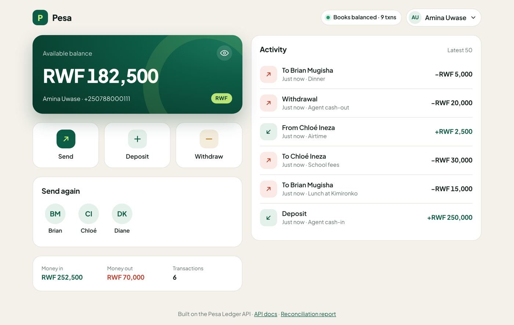
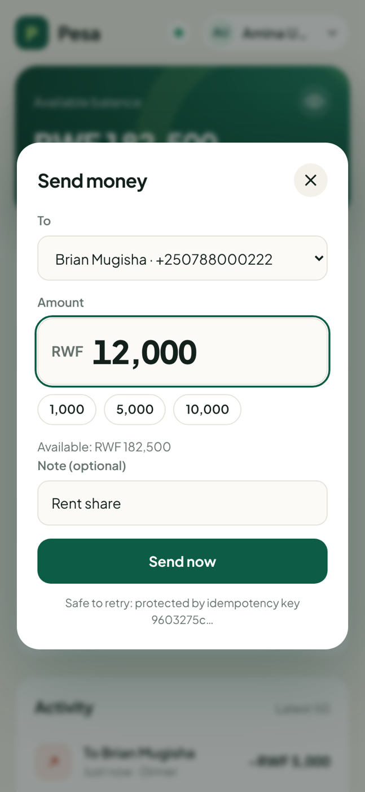

# 💸 Pesa Ledger API


**A mobile-money wallet back-end, like a small M-Pesa or MoMo, where money can
never be lost, duplicated or spent twice. And it can prove it.**

<p align="center">
  
  
</p>

Mobile money moves billions across Africa every day, often over unreliable
networks where phones retry requests. This API is built around the three
problems real payment systems must solve:

| Problem | How Pesa Ledger solves it |
|---|---|
| **Money appearing or disappearing** | **Double-entry ledger:** every transaction writes two entries that sum to zero, and `/reconciliation` proves the books balance |
| **A retried request paying twice** | **Idempotency keys:** the same `Idempotency-Key` always returns the original payment instead of making a new one |
| **Two payments spending the same money** | **Row locking** (`SELECT … FOR UPDATE`) in a fixed order, which also prevents deadlocks |

## 📱 The wallet app

A mobile-first web app in `web/` (plain HTML, CSS and JavaScript, no build step)
runs on top of the API at **http://localhost:8000**:

- Balance card, **Send / Deposit / Withdraw**, contacts and a live activity feed
- Every payment form creates its own **idempotency key**, so pressing *Send* twice
  or retrying after a network error can never pay twice
- A live **"Books balanced"** badge that calls `/reconciliation`
- Receipts show the transaction's two **ledger entries**
- **Load demo wallets** button to try it in one click

## ✅ Proven under load

`scripts/stress_test.py` runs against a live server on PostgreSQL, and runs
automatically on every push:

| Test | Result |
|---|---|
| 50 simultaneous transfers of 100 from a balance of 1,000 | Exactly **10 succeed**, 40 refused, final balance **0** |
| The same payment sent 20 times at once with one key | Money moves **exactly once** |
| 1,000 random transfers between 20 accounts, 50 at a time | **Total money unchanged, books balanced, zero errors** (~250 requests/second with 4 server workers) |

## 🧱 How it works

```
 Client ──▶ FastAPI routes ──▶ ledger.move_money() ──▶ PostgreSQL
            (validation)        1. replay check (idempotency key)
                                2. lock both accounts, in id order
                                3. check funds and currency
                                4. write transaction + 2 ledger entries
                                5. update cached balances, commit
```

- **Accounts** hold a cached `balance` for fast reads.
- **Transactions** record each deposit, withdrawal or transfer, plus its idempotency key.
- **Ledger entries** are the source of truth: `-amount` from one account, `+amount` to another.
- **System accounts** (one per currency) stand for money outside the wallet, such as
  agents and banks, so deposits and withdrawals are double-entry too.
- Amounts are **whole numbers in the smallest currency unit**, never floats, so rounding
  errors are impossible.

## 🚀 Run it

**With Docker (recommended, uses PostgreSQL):**

```bash
docker compose up --build
```

**Without Docker (uses SQLite, zero setup):**

```bash
python -m venv .venv
source .venv/bin/activate        # Windows: .venv\Scripts\activate
pip install -r requirements.txt
uvicorn app.main:app --reload
```

Then open **http://localhost:8000** for the wallet app, or
**http://localhost:8000/docs** for the interactive API documentation.

## 🧪 Test it

```bash
pytest -q                          # 17 unit tests
python scripts/stress_test.py      # concurrency and load test (server must be running)
```

## 📋 API

All money-moving requests need an `Idempotency-Key` header (any unique string, such as a UUID).

| Method | Endpoint | Purpose |
|---|---|---|
| POST | `/accounts` | Open a wallet `{owner_name, phone, currency}` |
| GET | `/accounts` | List all wallets |
| GET | `/accounts/{id}` | Wallet details and balance |
| GET | `/accounts/{id}/transactions` | Transaction history, newest first |
| POST | `/deposits` | Cash in `{account_id, amount}` |
| POST | `/withdrawals` | Cash out `{account_id, amount}` |
| POST | `/transfers` | Send money `{from_account_id, to_account_id, amount}` |
| GET | `/transactions/{id}` | One transaction with its ledger entries |
| GET | `/reconciliation` | Proof that the books balance |
| GET | `/health` | Liveness check |

**Responses:** `201` new payment · `200` + `Idempotent-Replayed: true` safe retry ·
`404` unknown account · `409` key reused for a different payment ·
`422` insufficient funds or invalid input.

Supported currencies: RWF, KES, XAF, NGN, USD.

## 🗺️ Roadmap

- Webhooks to notify merchants of payments, with retries
- API-key authentication and per-client rate limiting
- Database migrations with Alembic
- Daily reconciliation job and statement export

## 🧠 What I learned

- Why payment systems use **double-entry bookkeeping** and integer amounts
- How **race conditions** cause double spending, and how row locks prevent them
- How **idempotency** makes retries safe on unreliable mobile networks
- How to **prove** correctness with concurrency tests instead of just hoping

---

Built by Lesly Nana Tounda · [GitHub](https://github.com/DTounda) · [LinkedIn](https://linkedin.com/in/nana-dorcase-64a355312)
